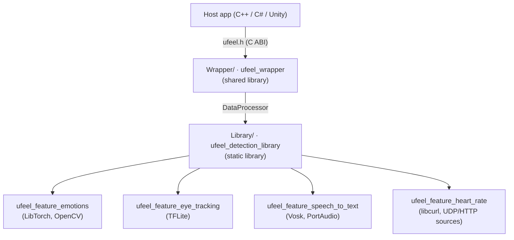

# Architecture

> [<- Back to README](../README.md)

UFeel is a native library with a C ABI, consumed from C++, C# and game engines.

## Layers

| Layer | Path | Role |
| --- | --- | --- |
| Library | [Library/](../Library) | C++ detectors, orchestrated by [DataProcessor](../Library/include/DataProcessor.hpp). One folder per domain under `include/` and `src/`. |
| Wrapper | [Wrapper/](../Wrapper) | C ABI over `DataProcessor`. Public header: [ufeel.h](../Wrapper/include/ufeel.h). Exports are restricted by [ufeel.map](../Wrapper/ufeel.map). Internals in `Wrapper/src/include/internal`. |
| Models | [models/](../models) | Model files per domain, each with its license. Installed into the package. |
| 3rdparty | [3rdparty/](../3rdparty) | Prebuilt dependencies (Git LFS) and the `yaml-cpp` submodule. See [THIRD_PARTY_NOTICES.md](../THIRD_PARTY_NOTICES.md). |

## Feature flags

Each domain (emotions, eye tracking, speech to text, heart rate) is toggled by a `UFEEL_ENABLE_*` CMake option, defined in [CMakeLists.txt](../CMakeLists.txt) and documented in the [README](../README.md#selecting-features). Rules:

- Guard domain code with `#if UFEEL_ENABLE_<DOMAIN>`.
- The C ABI must keep every symbol and return `UFEEL_STATUS_UNSUPPORTED_FEATURE` for disabled domains.
- The package only ships the models and runtime libraries of enabled domains.

## Adding a feature

1. Add the detector under `Library/include/<Domain>` and `Library/src/<Domain>`.
2. Expose it through `DataProcessor`, then through `ufeel.h` and `Wrapper/src/`.
3. Add tests mirroring the source tree, see [Testing](testing.md).
4. Document it in `docs/` and link it from the README table.

## Output

`./build.sh all` builds in `build/` and installs the package to `package/release` (or `package/debug`). The package holds `libufeel_wrapper.so`, `include/ufeel.h`, `models/` and `dependencies/`.
